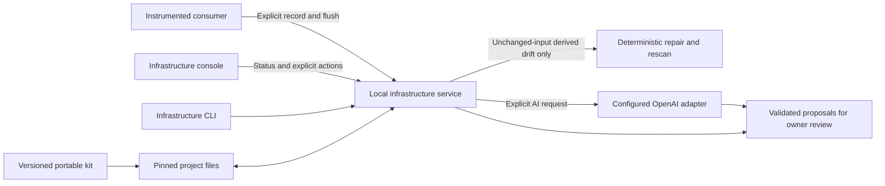

# Aegis as design-system infrastructure

Aegis Agentic now includes a local service for operating an installed design system. It pins a release and design profile, inventories component configuration, accepts explicitly permitted usage events, checks generated output, and prepares maintenance or update proposals. The profile compiler, component contracts, registry, composition renderer, and portable agent skills remain its foundation.

This is a single-project local implementation. The operator console reflects service responses; an unavailable service produces a disconnected state. Starting the workbench alone does not enable collection, call a model, or start a repair loop.

## Architecture



The source checkout builds the portable service into `agent-kit/infrastructure/`. Both the CLI and HTTP server use the same project store. The browser calls `/api/aegis`; Vite proxies that path to `http://127.0.0.1:4177`. The service binds to loopback and validates the request host, allowed browser origins, JSON bodies, and an explicit client header on writes. These checks are local request boundaries, not user authentication or role-based authorization.

Machine-readable boundaries are published in the [project schema](../schemas/project.schema.json) and [infrastructure HTTP contract](../contracts/infrastructure-api.json).

## Start a project

From the experiment repository, use Node 24 and the pinned package manager. Build the kit before running its infrastructure wrapper:

```sh
pnpm install --frozen-lockfile
npm run agentic:kit
npm run infrastructure -- init --project .aegis-workspace --id aegis-local --name "Aegis local infrastructure" --profile agent-kit/profiles/aegis.json
npm run infrastructure -- status --project .aegis-workspace
npm run infrastructure -- serve --project .aegis-workspace --port 4177
```

`init` requires a new directory and never overwrites an existing project. Choose a reviewed profile, including an exported custom profile, when initializing. Initialization compiles that profile, pins the kit/release/registry identities, and leaves telemetry and external AI disabled.

In another terminal, start the workbench and open its **Infrastructure** section:

```sh
npm run dev -- --host 127.0.0.1 --port 4175 --strictPort
```

The console provides manual refresh, service health, installed release, usage evidence, searchable component configuration, rules-based maintenance proposals, explicit AI opt-in per request, and a repair action when the service reports eligible derived drift. It labels stale snapshots and disables actions after a connection failure. Editing a design profile elsewhere in the workbench does not change the service's pinned project.

For a copied kit, replace `npm run infrastructure --` with `node agent-kit/infrastructure/cli.mjs`. Copy the complete `agent-kit/` directory; the service reads its runtime, integrity manifest, profiles, contracts, and reference API facts. The source repository is not required for these CLI operations.

## Project state and release identity

| File or directory   | Purpose                                                                                                              |
| ------------------- | -------------------------------------------------------------------------------------------------------------------- |
| `project.json`      | Project identity, exact release pin, source hashes, telemetry setting, and AI configuration. It contains no API key. |
| `profile.json`      | Approved normalized design profile.                                                                                  |
| `release.json`      | Pinned registry, token manifest, and configuration inventory.                                                        |
| `generated/`        | Compiled profile output, source lock, and maintenance evidence.                                                      |
| `usage-policy.json` | Allowed project/profile/component identifiers and optional finite technical props.                                   |
| `usage.json`        | Bounded local event buffer and recent batch receipts.                                                                |
| `plans/`            | Returned maintenance proposals, retained as JSON.                                                                    |
| `runs.json`         | The most recent 100 operation records; status exposes the latest 20.                                                 |
| `ai-budget.json`    | UTC-date request counter for remote advisory.                                                                        |
| `operation.lock`    | Exclusive local mutation lock.                                                                                       |

Writes use local files, exclusive operation locks, and atomic replacement of individual files. Concurrent mutation fails while another operation holds the lock. This is not a distributed database or a transaction across every project file. If a process crashes with a lock present, inspect the recorded process and project state before recovery; the service does not silently steal a lock.

Hashes detect accidental changes to the kit, approved profile, release, and generated source context. They are not authenticated release signatures. Editing a source file or pin does not constitute approval: identity mismatches become `review-required` and prevent automatic repair.

## Configuration inventory and verification

```sh
npm run infrastructure -- inventory --project .aegis-workspace
```

The inventory reads source-extracted public API facts. It identifies component parts, qualified prop names, boolean controls, literal choices, variants, source-declared defaults, and unbounded props. Theme, presentation, and behavior axes preserve whether classification was declared, inferred from a name, or unknown. Source labels are not a complete TypeScript or runtime value validator.

Possible configuration counts are capped Cartesian estimates over finite choices. They exclude unconstrained inputs and do not establish that every combination is valid. The default cap is one million combinations per component. Conditional rules, inherited props, arbitrary content, and interactions can make the estimate incomplete or include invalid combinations.

Verified coverage is a separate set of explicit configuration records, tied to the exact project/release/registry pin and accompanied by evidence references. Planned or failed records do not count as passed coverage; duplicate configurations do not inflate the count. The inventory validates record metadata and values, but does not execute the referenced tests or authenticate an evidence file. Zero verified configurations means this inventory has no accepted configuration records; it does not mean the library has no tests.

An unconstrained prop is also not automatically a defect. Children, render functions, callbacks, and application data often need flexibility. Maintenance proposals identify places to review, without automatically restricting them.

## Explicit usage collection

There are two opt-ins: the local project accepts events only after its setting is enabled, and each consumer's collector/client starts disabled. Workbench operator clicks are never counted as product usage.

```sh
npm run infrastructure -- usage-enable --project .aegis-workspace
npm run infrastructure -- usage-disable --project .aegis-workspace
```

Disabling the service stops acceptance and clears retained events and receipt history. The console's **Accept permitted usage events** control performs the same operation. Collection supports `render`, `action`, `configuration`, and `error` kinds with explicit component, project/registry, revision, profile, mode, and presentation identifiers. It does not infer users, sessions, adoption, or complete product coverage from event counts.

The initialized policy permits known component IDs but no prop values. Teams can explicitly review and allow technical boolean or finite-enum props in both client and server policies. Free text, UI content, URLs, credentials, DOM snapshots, and unknown keys are rejected. A finite enum is not permission to collect content under a prohibited prop name.

### Consumer SDK

Build the React package with `npm run build:package`. The `/agentic` entry exports `createUsageClient` and the policy types. A small consumer integration for the project above can use:

```ts
import {
  createUsageClient,
  type UsagePolicy,
  type UsageMode,
  type UsagePresentation,
} from '@dimitriszoitas/aegis-agentic/agentic';

// Match the reviewed server policy. This consumer only reports Button usage.
const policy: UsagePolicy = {
  version: 1,
  registries: ['aegis-local'],
  profiles: ['aegis'],
  components: { 'components-actions-button': { props: {} } },
};

const usage = createUsageClient({ policy, endpoint: '/api/aegis/usage' });

export function setUsageConsent(enabled: boolean) {
  usage.setEnabled(enabled);
}

export function recordButtonAction(mode: UsageMode, presentation: UsagePresentation) {
  return usage.record({
    registryId: 'aegis-local',
    registryRevision: 1,
    componentId: 'components-actions-button',
    profileId: 'aegis',
    kind: 'action',
    mode,
    presentation,
  });
}

export async function sendRecordedUsage() {
  return usage.flush();
}
```

Call the consent function from an explicit product decision, record only the actual host state, and choose when to flush. Use the installed project's IDs and revision instead of copying these example identities into another deployment. The current service uses the project ID as the allowed `registryId`. Route the consumer's `/api/aegis` path to the local service, or supply an explicit allowed endpoint. Changing the SDK endpoint does not grant a new browser origin access to the service.

Telemetry uses public API inventory IDs such as `components-actions-button`, as listed in the project's `usage-policy.json`. These differ from canonical contract-registry IDs such as `button`; they are not interchangeable. Read the installed inventory and policy before instrumenting a consumer.

`record()` only queues caller-supplied facts after validation; it returns whether the record was accepted. `flush()` sends at most 100 queued events and at most 60 KiB of UTF-8 JSON, then returns a structured result. There are no DOM observers, automatic storage, timers, background requests, or automatic retries. The default in-memory client queue holds 500 events, with an explicit maximum of 1,000; a full queue rejects new records. Concurrent flush calls share one in-flight request.

An uncertain delivery retains the exact batch ID and body for a caller-requested retry. The server remembers the last 1,000 batch receipts, rejects reuse of an ID with different content, and acknowledges recognized duplicates. This is bounded deduplication, not global exactly-once delivery: after receipt eviction or clearing, the same batch can be accepted again. The queue is memory-only and does not survive a page reload. Disabling or clearing the client cancels pending work as far as possible, but cannot retract a batch already accepted by the server. A server-disabled receipt also disables and clears the client; resumption requires explicit opt-in again.

The server accepts up to 100 events per batch, rejects the entire batch if an event is invalid, validates the pinned registry revision, and limits reported events to the previous 30 days and at most 10,000 entries. Reporting filters expired entries; successful ingestion rewrites the pruned buffer. There is no independent timed disk-purge job. For controlled CLI ingestion, `usage-ingest --file events.json` expects an array of complete version-1 `UsageEvent` objects, including timestamps, rather than an export envelope.

## Deterministic maintenance and periodic repair

```sh
npm run infrastructure -- plan --project .aegis-workspace
npm run infrastructure -- reconcile --project .aegis-workspace
```

`plan` uses local rules by default and saves reviewable proposals. `reconcile` inspects identity and health, repairs only eligible generated-output drift, then independently rescans. It preserves repair evidence and does not approve changed profile sources, component behavior, contract versions, tokens, dependencies, or releases.

Periodic checks are optional:

```sh
npm run infrastructure -- serve --project .aegis-workspace --port 4177 --reconcile-interval 60
```

The interval is in seconds, from 30 through 86,400. Each cycle checks health and invokes repair only for `drift`; cycles do not overlap. A repair is bounded to the existing deterministic regeneration operation and its validation. A service left running may attempt eligible drift again on a later cycle, so this is not a global retry limit. No periodic AI analysis, arbitrary code repair, commit, or release occurs. The loop stops when the process stops; it is not installed as an operating-system service or scheduler.

## Proposed release updates

```sh
npm run infrastructure -- updates --project .aegis-workspace --target /path/to/reviewed-target-release.json
```

The target is an `InfrastructureUpdateSnapshot`, with the same project identity and a supported exact kit version, plus registry, token-manifest, or inventory evidence. An initialized project's `release.json` demonstrates the snapshot structure. The planner compares supplied snapshots, checks pin compatibility, identifies breaking/additive/review impacts, and reports affected component usage where available. It does not infer a complete dependency graph or treat missing usage as proof that an update is safe.

Every update plan is `plan-only`, with `applied: false`; it performs no migration and inherits no verification coverage. The current service only declares the project's pinned kit version supported, so a different version may be blocked until compatibility support and owner review are provided.

There is no in-place release/profile adoption command in this experiment. Review changed sources and target artifacts, then initialize a new project directory for the accepted inputs while preserving the previous project and evidence. Do not edit hashes or pin files to bypass review. Distribution, Git review, publishing, and consumer adoption remain deliberate steps outside this service.

## Optional AI advisory

Supply `OPENAI_API_KEY` in the service process environment, using your normal local secret handling. The key is server-only; it is not stored in the project, included in a kit, or passed to the browser. Then explicitly enable a compatible model for that project:

```sh
npm run infrastructure -- ai-enable --project .aegis-workspace --model YOUR_COMPATIBLE_MODEL_ID
npm run infrastructure -- plan --project .aegis-workspace --ai
npm run infrastructure -- ai-disable --project .aegis-workspace
```

Replace the model placeholder with an explicit model compatible with the adapter's structured-response request. If the service was started without its key, restart it with the configured environment. In the console, **Include AI analysis** is available only when the service reports a configured provider, and starts unchecked.

The adapter calls the OpenAI Responses endpoint with `store: false`, a strict JSON schema, a 3,000-output-token ceiling, and a 25-second request timeout. For provider schema behavior, see OpenAI's [Structured Outputs guide](https://developers.openai.com/api/docs/guides/structured-outputs). The initialized project allows five remote requests per UTC day; failed attempts also consume a slot. This request counter is not a monetary spending cap.

Only the service's selected aggregate evidence is sent: component/evidence IDs, health findings, configuration counts, and usage counts by kind, mode, presentation, and component. Raw usage events, prop-value distributions, arbitrary project prose, and API keys are not part of that evidence payload. Setting `store: false` describes the request option; it is not a claim about every provider retention policy.

Returned proposals must match the schema, reference known components and supplied evidence IDs, and stay within the proposal limits. They are stored for owner review with `verification: 'proposal-only'`. The model has no tool to execute code, alter source, approve behavior, weaken checks, or publish a release. Local rules and provider failures remain explicit; an unavailable provider is never replaced with fabricated AI results.

## API boundary

| Endpoint                         | Purpose                                                                                  |
| -------------------------------- | ---------------------------------------------------------------------------------------- |
| `GET /api/aegis/status`          | Project, pin, health, usage, capability counts, provider configuration, and recent runs. |
| `GET /api/aegis/configurability` | Full configuration inventory.                                                            |
| `POST /api/aegis/plan`           | `{ "useAI": false }` by default; returns a proposal-only maintenance plan.               |
| `POST /api/aegis/reconcile`      | `{}` requests bounded derived repair.                                                    |
| `POST /api/aegis/usage/settings` | `{ "enabled": true }` opts in; `false` also clears retained usage and receipts.          |
| `POST /api/aegis/usage`          | `{ "batchId": "…", "events": [] }` submits a validated batch.                            |

POSTs require `Content-Type: application/json` and `X-Aegis-Client: console` or `sdk`; the HTTP body limit is 64 KiB. The console and SDK supply those headers, and the SDK leaves room below that body limit. The browser's AI configuration and update adoption are not HTTP endpoints; project AI configuration and update planning currently use the CLI. The default origin allowlist covers the repository's local development/test ports, not arbitrary deployments. Extending deployment access requires an explicit service integration.

## Verification and current limits

```sh
npm run infrastructure:test
npm run agentic:test
npm run agentic:browser
```

The infrastructure tests exercise service state, integrity refusal, bounded repair, event validation, receipts, and provider behavior using controlled test responses. Browser checks cover unavailable/malformed APIs, explicit consent, rules/AI selection, failure states, repair eligibility, stale snapshots, and accessibility. AI browser/provider tests are simulated; they do not establish a successful live model call.

With the service and Vite running, `node scripts/verify-infrastructure-live.mjs` performs a real read-only console check. Set `INFRASTRUCTURE_TEST_PLAN=1` only when intentionally allowing that check to persist one local rules-based plan. The checked live service showed its real inventory, zero usage, and an unconfigured AI adapter; no paid AI call was verified.

Current limits are one local project per service, local files and locks, manual consumer instrumentation, bounded receipt deduplication, and explicit source/release review. There is no hosted multi-user control plane, enterprise authentication, distributed coordination, automatic update adoption, universal coverage certification, or globally exactly-once telemetry. Maintenance plans and repair evidence need normal project storage management. These are implementation boundaries of the current experiment, not capabilities implied by the word “agentic.”

Potential next phases are authenticated hosting with durable shared storage, signed release distribution, and reviewed migrations between pins with rollback and fresh consumer verification. Those require separate architecture and acceptance work; they are not features delivered by this local service.
